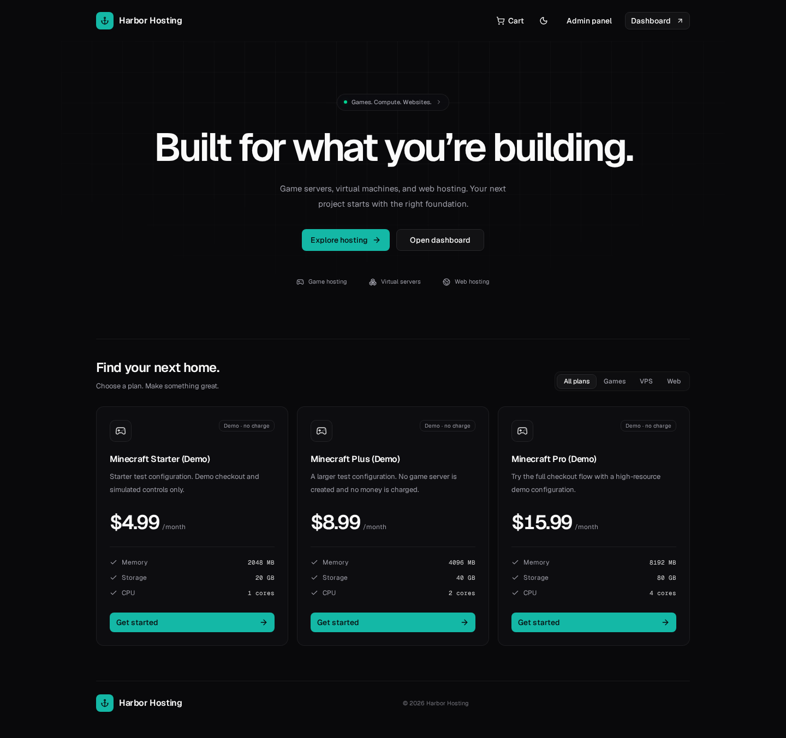
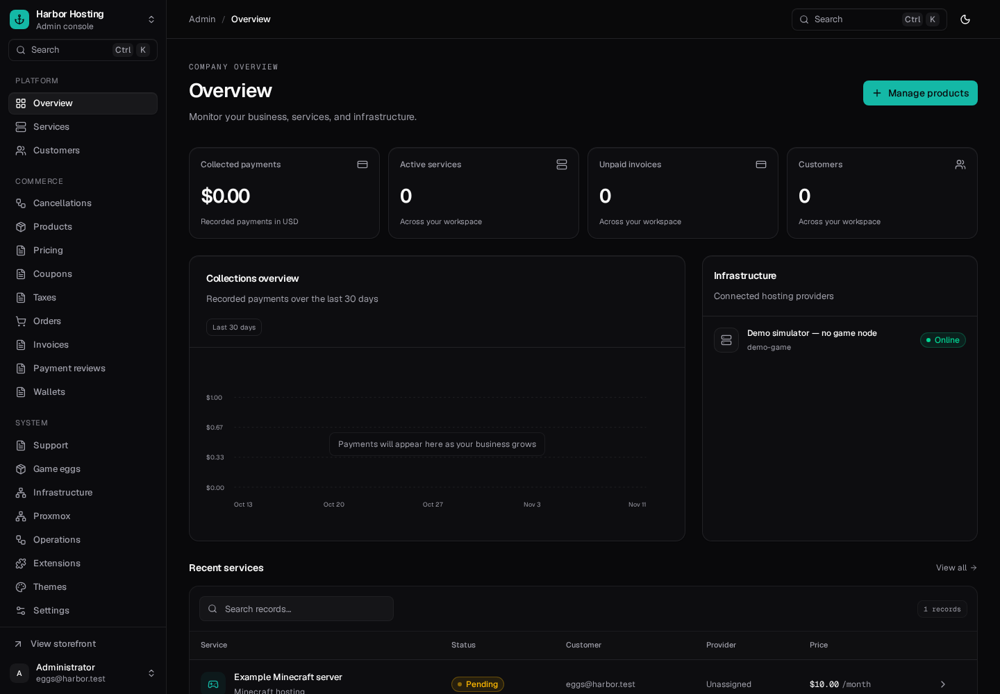
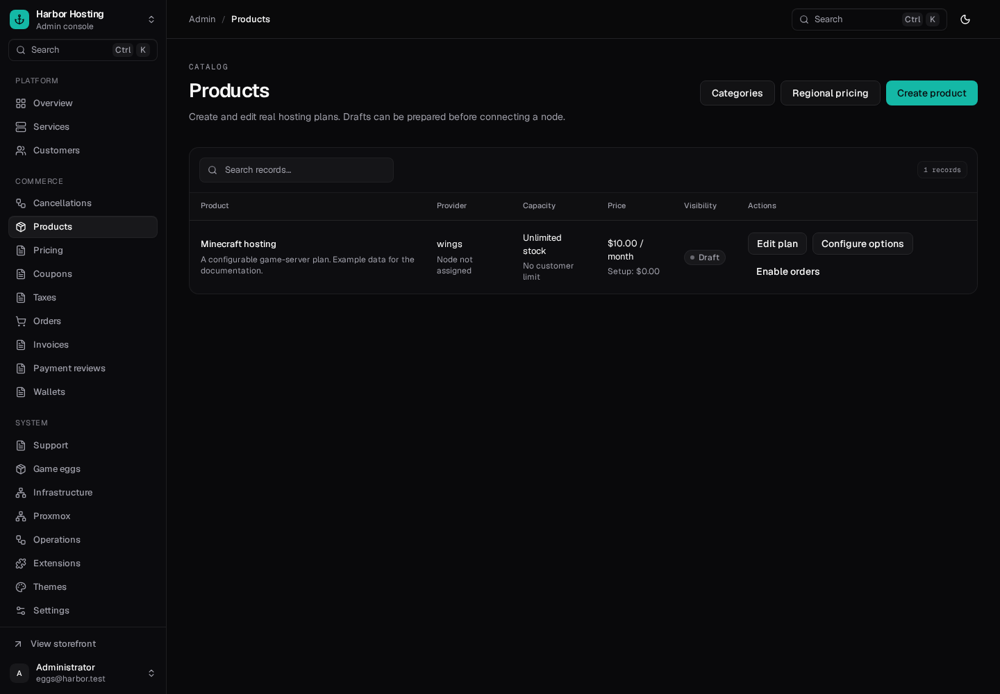
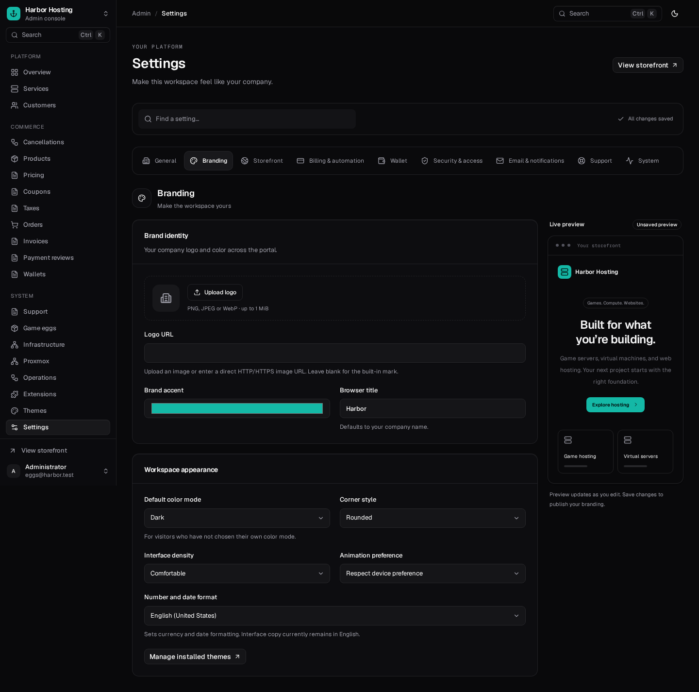
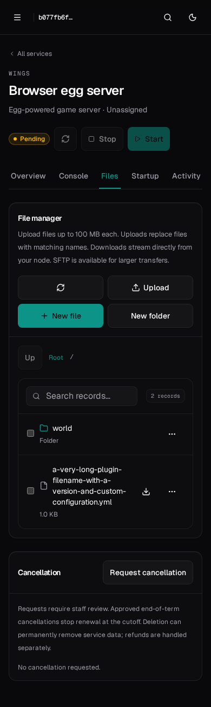
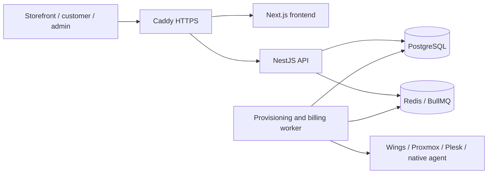

<div align="center">

# Harbor

**A self-hosted storefront, billing platform, and hosting control panel.**

Sell game servers, virtual servers, and web hosting from one customer and administrator workspace.

[Installation](docs/installation.md) · [First steps](docs/getting-started.md) · [Providers](docs/providers.md) · [Operations](docs/operations.md) · [API](docs/api.md) · [Plugins & themes](docs/extensions.md)



</div>

## What Harbor includes

| Area           | Features                                                                                                                                                                      |
| -------------- | ----------------------------------------------------------------------------------------------------------------------------------------------------------------------------- |
| Storefront     | Optional public storefront, categories, stock limits, configurable plans/options, coupons, regional currency pricing, cart and combined checkout                              |
| Game hosting   | Direct Pterodactyl Wings integration, imported PTDL v1/v2 eggs, automatic stable Paper downloads with SHA-256 verification, isolated node setup, console, SFTP and file tools |
| VPS hosting    | Proxmox QEMU and LXC provisioning, nodes, storage, networks, IP pools, locations and browser consoles                                                                         |
| Web hosting    | Plesk integration and an optional native web-hosting agent                                                                                                                    |
| Billing        | Numbered invoices, PDF downloads, tax and billing snapshots, partial receipts, wallet balances, verified deposits, Stripe, PayPal and offline payments                        |
| Customers      | Billing profiles, login history, password/session management, suspension, support tickets, private staff notes and attachments                                                |
| Administration | Company branding, storefront controls, SMTP/templates, maintenance, automation, audit/HTTP metadata and queued operation monitoring                                           |
| Extensibility  | Scoped customer/admin API keys, OpenAPI documentation, backend plugins, provider/gateway adapters and frontend themes                                                         |
| Interface      | Dark default, responsive layouts, keyboard search, light mode, motion preferences and mobile navigation                                                                       |

Harbor is an **early release**. Implemented provider adapters need validation against your own infrastructure. Saved-card recurring collection, prorated upgrades/downgrades, gateway refunds, domain registration, full translations and granular staff roles are not implemented. See [feature status](docs/feature-status.md). Harbor is an independent project; it is not a Pterodactyl or Paymenter distribution.

## Quick installation

Use a **fresh Ubuntu 24.04 server** with a public domain pointing to it. Allow inbound TCP 80/443. A practical starting allocation is 2 CPU cores, 4 GB RAM and sufficient disk for builds, uploads and backups; game/VPS workloads need their own capacity.

```bash
sudo apt-get update
sudo apt-get install -y git
sudo git clone https://github.com/Mizo-Development/harbor-panel.git /opt/harbor
cd /opt/harbor
sudo bash scripts/install.sh --domain panel.example.com --email ops@example.com
```

The installer sets up Docker Compose, generates persistent secrets, applies database migrations, builds Harbor and obtains HTTPS through Caddy. It does not create a default administrator password or include customer/provider credentials.

1. Open `https://panel.example.com/setup`.
2. Read `SETUP_TOKEN` from `/opt/harbor/.env` privately; enter it in the setup wizard.
3. Create your administrator account and select local or remote game nodes.
4. Configure company details, email, payment methods and provider connections.
5. Publish plans only after validating the assigned provider connection.

See [the installation guide](docs/installation.md) for DNS, ports, requirements, existing Docker installations, alongside-panel Wings, manual Compose setup and troubleshooting.

## Screenshots

These previews use an isolated environment with fictional users and sample plans. They contain no live customer records. No sample plans are installed in a new production deployment.

| Administrator workspace                                   | Hosting plans                                     |
| --------------------------------------------------------- | ------------------------------------------------- |
|  |  |

| Company settings                                              | Game file manager on mobile                                                                  |
| ------------------------------------------------------------- | -------------------------------------------------------------------------------------------- |
|  |  |

[More previews](docs/screenshots/README.md)

## Architecture



The API enforces ownership, permissions, prices and payment state. Durable operations provision hosting after payment. Service configuration and issued billing details are snapshotted so later plan/company edits do not rewrite existing contracts or invoices.

| Component    | Stack                                           |
| ------------ | ----------------------------------------------- |
| Frontend     | Next.js, React, Tailwind CSS, shadcn/ui, Motion |
| API / SDK    | TypeScript, NestJS, Zod, Prisma                 |
| State / jobs | PostgreSQL 17, Redis 7.4, BullMQ                |
| Deployment   | Node.js 24, Docker Compose, Caddy               |

## Guides

- [Install and complete setup](docs/installation.md)
- [Configure your first company, node, plan and order](docs/getting-started.md)
- [Wings, Proxmox, Plesk and native web hosting](docs/providers.md)
- [Invoices, wallets, tax and regional pricing](docs/billing.md)
- [Backups, upgrades, restores and troubleshooting](docs/operations.md)
- [Customer and administrator APIs](docs/api.md)
- [Develop plugins and themes](docs/extensions.md)
- [Local development and tests](docs/development.md)
- [Implemented features and limitations](docs/feature-status.md)

## API and integrations

Open `/api/docs` on your own installation for the interactive reference, or `/api/docs-json` for OpenAPI. Customer keys live in **Dashboard → API keys**; administrators use **Admin → API access**. Keys have explicit scopes, expiry and optional CIDR restrictions. Key management requires a dashboard session and current credentials.

```bash
export HARBOR_API_URL='https://panel.example.com/api/v1'
# Set HARBOR_API_KEY privately; do not commit it.
curl --fail --silent --show-error   -H "Authorization: Bearer $HARBOR_API_KEY"   "$HARBOR_API_URL/services"
```

No third-party hosting service, payment account, SMTP account or provider license is bundled. Install only plugins and eggs whose code you trust; their scripts execute with their documented application/node privileges.

## Development

For Node.js 24, PostgreSQL 17 and Redis:

```bash
npm ci
# Optional local PostgreSQL/Redis containers:
docker compose -f compose.dev.yaml up -d
npm run dev:setup
npm run dev
# In another terminal:
npm run worker
```

Open `http://localhost:3000/setup` and use the generated setup token in `.env`. Development database defaults are local-only examples. Production uses independently generated secrets.

```bash
npm run db:generate
npm run build
npm run typecheck
npm test
```

Integration and browser tests require a dedicated database whose name ends in `_test`; they reset its test records. See [development instructions](docs/development.md).

## Repository contents

This repository includes application/SDK source, migrations, deployment and backup scripts, example extensions, tests, guides and curated screenshots. It excludes deployment secrets, database dumps, uploaded files, customer data, runtime volumes, generated builds, dependency folders and private installation logs.

## Licensing and credits

Project-wide licensing is being finalized. Third-party licenses are retained with their assets; see [third-party notices](THIRD_PARTY_NOTICES.md).
