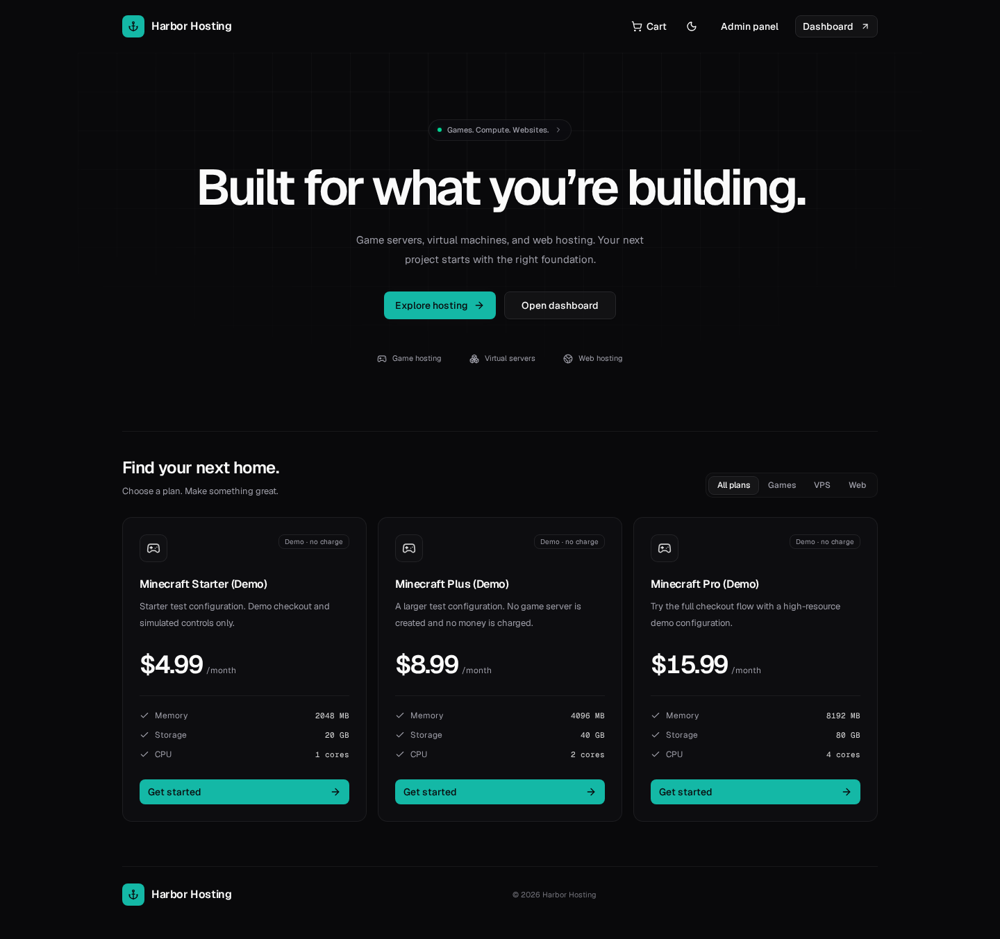
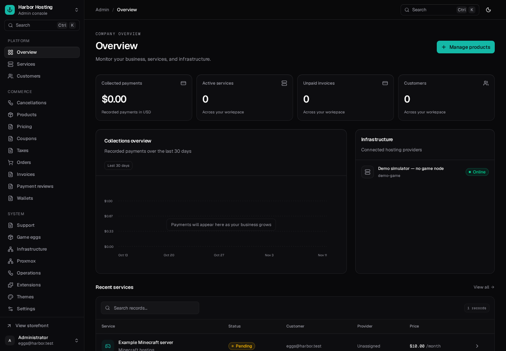
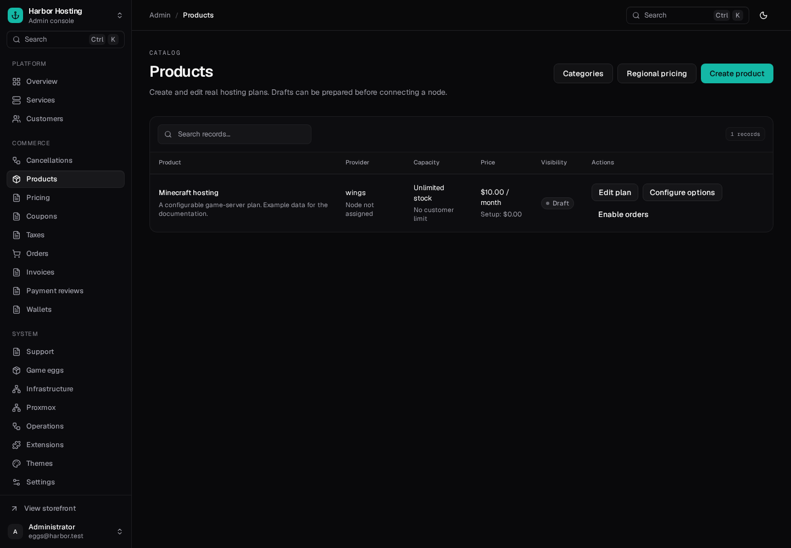
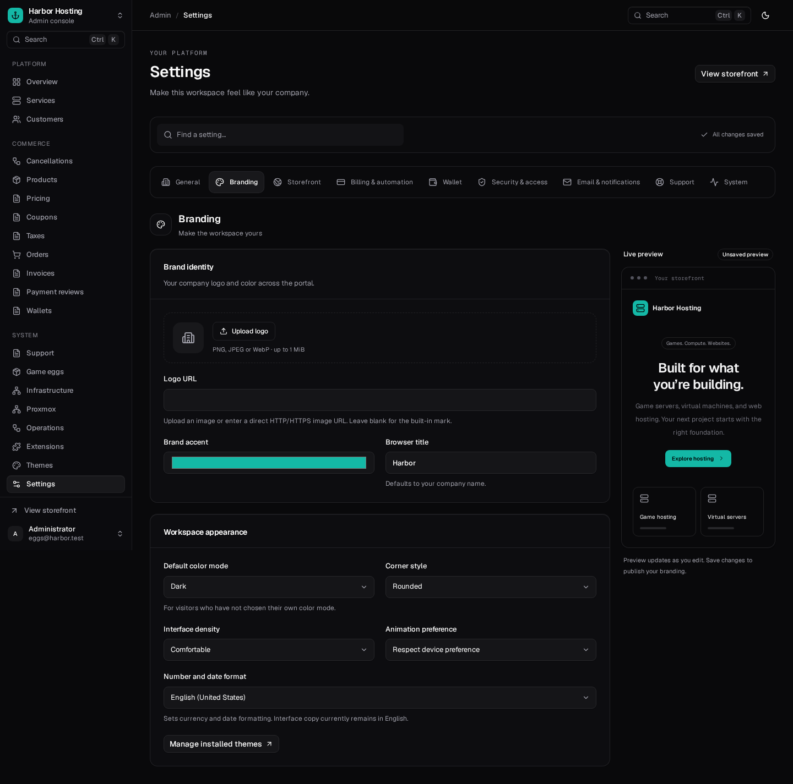
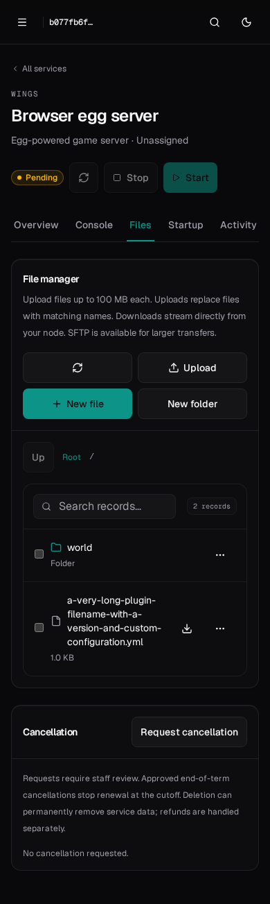

# Interface previews

Previews use an isolated environment with fictional `.test` accounts and sample plans. They are UI illustrations, not live customer data or a claim that sample orders created real hosting. No sample plans are installed automatically in production.

## Storefront

## Administrator overview

## Plan management

## Company branding

## Mobile file management

The example service and file list below are test fixtures used to check mobile layouts.

